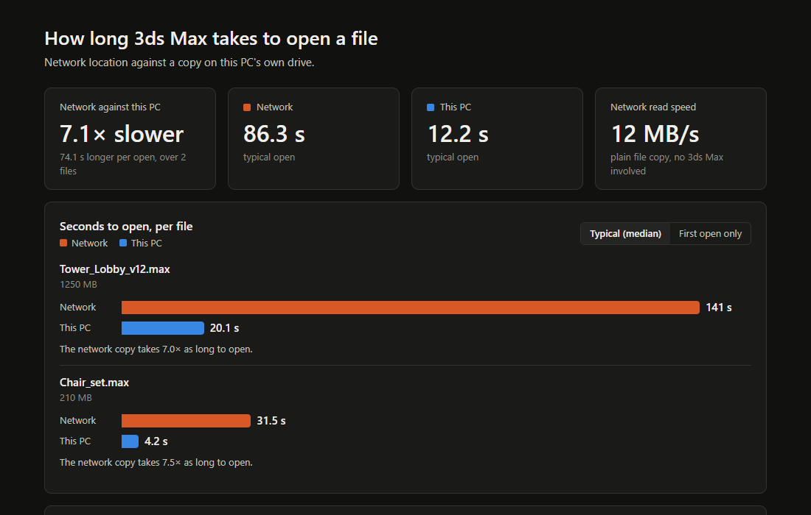

# Load Timer

Times how long 3ds Max takes to open a `.max` file, and compares the file where it lives (for example a network share) with a copy on the PC's own drive. The results show up as a bar chart in your browser.

It exists to answer one question with numbers: *is the network making my scenes slow to open?*

*The numbers in the screenshot are made up to show the layout.*

## What you need

- 3ds Max on Windows (tested on 2027; written for 2026 and later)
- Any modern browser for the chart

## How to use it

1. Download this folder and keep `LoadTimer.ms` and `LoadTimer.html` together.
2. **Save your scene.** Timing a file resets the scene (the tool asks before discarding unsaved changes).
3. In 3ds Max: **Scripting > Run Script...** and pick `LoadTimer.ms`.
4. Press **Pick a .max file and time it...** and choose a file, usually one on the network.
5. Press **Open the chart**. The page refreshes itself every few seconds, so you can leave it open while you time more files.

For each file the tool:

1. opens it from where it is, several times (3 by default), each time from an empty scene;
2. copies it to a temp folder on this PC and times the copy;
3. opens the local copy the same number of times;
4. deletes the local copy and leaves an empty scene.

### Options

| Option | What it does |
|---|---|
| Note | Free text saved with each measurement, e.g. "Monday 9am" or "over VPN". |
| Opens per location | How many times to open the file from each place (1 to 10). |
| Also time a copy on this PC | Turn off to time only the file you picked. |
| Copy to | Where the local copy goes. Defaults to your temp folder. |
| Clear results | Deletes every recorded time. |

## Reading the chart

- **Network against this PC** - how many times slower (or faster) the network is, over the files that were timed in both places.
- **Bars** - seconds to open each file, network against this PC. Hover a bar for the fastest and slowest open.
- **Typical (median) / First open only** - the median of all opens, or only the first open of each test.
- **Network read speed** - MB/s of the plain file copy, with no 3ds Max involved. If this is low, the network is slow whatever the scene contains.
- **Every measurement** - the raw table: time, file, location, seconds, size, PC name and path.

## What the numbers mean, and their limits

- **Only the `.max` file is copied.** Textures, proxies, XRefs and other assets the scene points to still load from wherever they are. If they are on the network, the "This PC" bar includes that network time too, so the real gap is at least as big as the chart shows.
- **The Windows file cache is dropped before each open**, so repeat opens are not artificially fast. This is best effort and may not take effect on every network share. If opens 2 and 3 from the network are much faster than the first, use **First open only**.
- Timing covers `loadMaxFile` only: from an empty scene until the file has loaded. Starting 3ds Max itself is not included.
- Other things running on the PC or the network at the time will move the numbers. Several opens at different times of day make a stronger case than one.

## Files

| File | What it is |
|---|---|
| `LoadTimer.ms` | The script you run in 3ds Max. |
| `LoadTimer.html` | The chart page. Reads `load_times.js` from the same folder. |
| `load_times.js` | Created by the script: one line per measurement. Delete it (or press Clear results) to start over. |

Nothing is sent anywhere: the results stay in that one file next to the script, and the chart page works offline.

## Licence

GPL-3.0-or-later. See [LICENSE](LICENSE).

Autodesk and 3ds Max are registered trademarks of Autodesk, Inc. This project is not affiliated with or endorsed by Autodesk.
